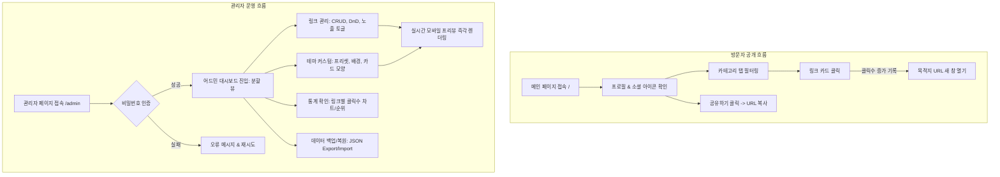

# [PRD] 마이링크 (MyLink) — 1인 맞춤형 링크트리 솔루션

---

## 1. 프로젝트 개요 (Overview)

### 1.1 서비스 정의
**마이링크 (MyLink)**는 개발자, 크리에이터, 디자이너 등 개인 사용자가 자신의 포트폴리오, 소스코드 저장소, 소셜 미디어, 기술 블로그 등의 링크를 한곳에 집약하고 모던한 UI로 방문자에게 제공할 수 있는 **1인 전용(Single User) 링크트리 클론 서비스**입니다.

### 1.2 개발 배경 및 목표
- **간편한 브랜딩**: 복잡한 웹사이트 제작 없이도 자신만의 개성이 드러나는 링크 모음 페이지 구축
- **무서버/무DB 신속 운영**: 외부 클라우드 DB 가입 및 설정 없이 브라우저의 `localStorage` 기반으로 즉시 실행 및 영구 보존
- **직관적인 관리자 경험**: 링크트리 특유의 **분할 뷰(Split-screen)**를 통해 좌측 편집 내용이 우측 스마트폰 화면에 실시간으로 반영되는 높은 편의성 제공
- **안전한 데이터 보존**: 브라우저 캐시 삭제 등에 대비하여 원클릭 JSON 데이터 내보내기(Export) 및 복원(Import) 지원

---

## 2. 시스템 아키텍처 & 기술 스택 (Architecture & Tech Stack)

| 계층 | 기술 스택 | 선정 이유 |
| :--- | :--- | :--- |
| **Framework** | Next.js 15 (App Router), React 19 | SSR/SSG 지원 및 최신 React 컴포넌트 아키텍처 활용 |
| **Language** | TypeScript 5.7+ | 엄격한 타입 정의를 통한 안정적 데이터 구조 관리 |
| **UI Component System** | **shadcn/ui** (Base UI 프리셋) | 일관된 디자인 시스템 구축, 높은 접근성(A11y), 재사용 가능한 아토믹 컴포넌트(`Button`, `Card`, `Badge`, `Avatar`, `Tabs`, `Dialog`, `Input`) 아키텍처 |
| **Styling** | **Tailwind CSS v4** (CSS-first, `@theme inline`), Lucide React | 별도 config 및 CSS Module(`*.module.css`) 사용을 배제하고 Tailwind CSS v4 단일 체계로 스타일 통일. OKLCH 기반 토큰 관리 및 모던 아이콘 세트 |
| **State Management** | **Zustand** (`persist` 미들웨어) | 초경량(1KB), `localStorage` 자동 영속화, 관리자 분할 뷰 실시간 렌더링 최적화, SSR 하이드레이션 제어 |
| **Drag & Drop** | `@hello-pangea/dnd` 또는 `@dnd-kit` | 터치/마우스 환경에서 안정적인 순서 변경 UX 제공 |
| **Data Storage** | Browser `localStorage` | 외부 서버/DB 종속성 없이 브라우저 내에서 즉각적이고 영속적인 데이터 보관 |
| **Data Migration** | JSON File Export / Import | 브라우저 변경이나 기기 이동 시 데이터 유실 방지 및 백업 지원 |
| **Security/Auth** | Local Hash 기반 관리자 비밀번호 검증 | 경량 단일 사용자 어드민 보호 |

---

### 2.1 전역 상태 관리 스토어 설계 (Zustand Architecture)

```typescript
// Zustand 기반 스토어 액션 및 라이프사이클 설계
interface MyLinkStore {
  data: MyLinkData;
  isHydrated: boolean;          // Next.js SSR 하이드레이션 불일치 방지 플래그
  setHydrated: () => void;

  // 프로필 액션
  updateProfile: (profile: Partial<ProfileConfig>) => void;

  // 링크 관리 액션
  addLink: (link: Omit<LinkItem, 'id' | 'order' | 'clickCount' | 'createdAt' | 'updatedAt'>) => void;
  updateLink: (id: string, updates: Partial<LinkItem>) => void;
  deleteLink: (id: string) => void;
  reorderLinks: (reorderedLinks: LinkItem[]) => void;
  toggleLinkVisibility: (id: string) => void;
  incrementClick: (id: string) => void;

  // 테마 & 디자인 액션
  setThemePreset: (presetId: ThemeConfig['presetId']) => void;
  updateTheme: (updates: Partial<ThemeConfig>) => void;

  // 데이터 마이그레이션 & 초기화
  importData: (importedData: MyLinkData) => boolean;
  exportData: () => string;     // JSON 문자열 반환
  resetToDefault: () => void;

  // 인증
  setAdminPassword: (password: string) => void;
  verifyAdminPassword: (password: string) => boolean;
}
```

---

## 3. 핵심 사용자 흐름 (User Flow)



---

### 3.1 사용자 페르소나 (Target Personas)

| 구분 | 페르소나 A: 관리자 / 소유자 (Primary) | 페르소나 B: 외부 방문자 (Secondary) |
| :--- | :--- | :--- |
| **이름 및 프로필** | **김나린 (23세, 대학생)** | **이현우 (31세, 테크 리크루터 / 개발자)** |
| **소속 / 상태** | 공간정보공학과 학부 3학년 재학 중 | IT 스타트업 개발팀 채용 담당자 |
| **주요 목표** | • 분산된 본인의 프로젝트(GitHub, GIS 웹, 블로그)를 한곳에 모아 모던하게 브랜딩<br>• 학기 및 프로젝트 진행 상황(상태 뱃지)을 유연하게 업데이트<br>• 이력서 및 인스타그램 바이오에 단일 링크로 공유 | • 지원자/크리에이터의 대표 작업물과 활동 이력을 빠르고 한눈에 파악<br>• 원하는 분야(예: 지도 연구, 코드 저장소)의 링크를 선별 탐색 |
| **주요 행동 패턴**| • PC/노트북으로 `/admin`에 접속하여 실시간 프리뷰를 보며 링크와 테마를 튜닝<br>• 주기적으로 백업 파일을 보관 | • 모바일 스마트폰 환경에서 인스타그램 프로필이나 이력서 링크를 터치해 접속 |

---

### 3.2 상세 사용자 시나리오 (Detailed User Scenarios)

#### 📌 시나리오 1: 관리자의 최초 프로필 설정 및 링크 등록
- **상황**: 나린은 포트폴리오 제출용 단일 링크 페이지를 만들기 위해 마이링크 서비스를 처음 사용한다.
- **진행 과정**:
  1. 관리자 페이지(`/admin`)에 접속하여 최초 관리자 비밀번호를 설정한다.
  2. [프로필 설정] 탭에서 자신의 프로필 사진을 내 PC에서 업로드하고, 이름("김나린"), 소속("OO대학교 공간정보공학과 학부생"), 상태 뱃지("학부 3학년 재학 중"), 자기소개글을 작성한다.
  3. 상단에 노출될 소셜 링크(GitHub 주소, 학교 이메일)를 등록한다.
  4. [링크 관리] 탭으로 이동하여 자신의 주요 3대 링크(GitHub 저장소, GIS 웹 지도 연구소, 기술 블로그)를 추가하고, 각각 "실시간 커밋", "인터랙티브", "스터디 노트" 뱃지를 단다.
  5. 우측 **실시간 모바일 프리뷰**에서 실제 스마트폰 화면과 똑같이 렌더링되는 모습을 확인하고 만족스럽게 창을 닫는다. (데이터는 `localStorage`에 자동 영구 저장됨)

#### 📌 시나리오 2: 링크 순서 재배치(DnD) 및 디자인 테마 변경
- **상황**: 최근 완성한 "GIS 웹 지도 연구소" 프로젝트를 가장 돋보이게 만들기 위해 상단으로 올리고, 테마를 화사하게 바꾸고자 한다.
- **진행 과정**:
  1. `/admin`에 로그인하여 [링크 관리] 탭을 연다.
  2. "GIS 웹 지도 연구소" 카드 좌측의 드래그 핸들을 잡고 마우스로 끌어 목록 맨 위로 끌어올린다(Drag & Drop).
  3. 우측 프리뷰 창에서 즉각 해당 링크가 최상단으로 재정렬되는 것을 실시간으로 확인한다.
  4. [테마 커스텀] 탭으로 이동하여 '모던 다크'에서 산뜻한 '클린 미니멀 화이트' 프리셋을 클릭한다.
  5. 카드 모서리를 'Rounded(둥글게)'로 선택하고, 강조 컬러를 청록색(#00D4EA)으로 튜닝하여 개성 있는 디자인을 완성한다.

#### 📌 시나리오 3: 특정 링크 임시 숨김(토글) 및 데이터 백업(Export)
- **상황**: 리팩토링 중인 기술 블로그 글 링크를 며칠간 비공개로 돌리고, 브라우저 정리에 대비해 데이터를 안전하게 백업해두려 한다.
- **진행 과정**:
  1. `/admin` [링크 관리] 탭에서 "기술 블로그" 카드의 **[노출 스위치]**를 클릭하여 OFF로 전환한다. 링크를 삭제하지 않고도 우측 모바일 프리뷰와 공개 화면에서 즉시 사라지는 것을 확인한다.
  2. [설정 & 백업] 탭으로 이동하여 **[JSON 백업 다운로드]** 버튼을 클릭한다.
  3. `mylink_backup_20261115.json` 파일이 다운로드 폴더에 안전하게 저장된다. (추후 다른 PC나 브라우저에서 '복원' 버튼으로 원클릭 복구 가능)

#### 📌 시나리오 4: 외부 방문자의 링크 탐색 및 공유
- **상황**: 채용 담당자 현우는 지원자 나린의 이력서에 적힌 마이링크 URL을 모바일 브라우저로 열람한다.
- **진행 과정**:
  1. 메인 화면에 들어서자마자 깔끔한 프로필 사진과 "학부 3학년 재학 중" 뱃지를 보고 지원자의 신분을 명확히 인지한다.
  2. 상단 소셜 바의 GitHub 아이콘을 눌러 잔디 커밋을 확인한다.
  3. 메인 링크 영역에서 카테고리 탭 중 **"지도 연구"**를 터치하여 연관 프로젝트 카드만 필터링한다.
  4. "GIS & 웹 지도 연구소" 카드를 터치하자 새 탭에서 멋진 인터랙티브 지도 웹앱이 실행된다. (이 순간 마이링크 스토어에는 해당 링크 클릭 수가 +1 카운트된다.)
  5. 동료 개발자에게 지원자를 추천하기 위해 우측 상단 **[공유하기]** 버튼을 눌러 링크를 클립보드에 복사하고 메신저에 붙여넣는다.

#### 📌 시나리오 5: 관리자의 클릭 반응(Analytics) 확인
- **상황**: 나린은 이력서 제출 후 방문자들이 자신의 어떤 링크에 관심이 많은지 확인하고 싶다.
- **진행 과정**:
  1. `/admin` 로그인 후 **[통계]** 탭을 클릭한다.
  2. 전체 누적 클릭 수와 함께 링크별 클릭 순위(1위: GIS & 웹 지도 연구소, 2위: GitHub 리포지토리)를 확인한다.
  3. 어떤 프로젝트가 사람들의 이목을 끄는지 데이터를 바탕으로 파악하고, 다음 학습/프로젝트 우선순위를 결정한다.

---

## 4. 상세 기능 요구사항 (Functional Requirements)

### 4.1 공개 링크 페이지 (`/`)

#### 4.1.1 모바일 뷰 화면 와이어프레임 (Wireframe)

```text
┌────────────────────────────────────────────────────────┐
│  [✨ MyLink]                                [ 🔗 공유 ] │  <-- 네비게이션 헤더
├────────────────────────────────────────────────────────┤
│                                                        │
│                    ┌──────────────┐                    │
│                    │  프로필 사진  │                    │
│                    │   (아바타)   │                    │
│                    └──────────────┘                    │
│                        김 나 린                        │
│            공간정보공학과 학부 3학년 재학 중           │
│                                                        │
│             [ 🟢 학부 3학년 재학 중 ]                  │  <-- 현재 상태 뱃지
│                                                        │
│     "공간 데이터 시각화와 모던 웹 프론트엔드 기술을    │
│      탐구하는 개발자 지망생 김나린입니다."             │
│                                                        │
│       📍 서울특별시         ✉️ narin@example.com       │
│                                                        │
│     [ GitHub ]   [ LinkedIn ]   [ Instagram ]   [ Mail ]│  <-- 소셜 아이콘 바
│                                                        │
├────────────────────────────────────────────────────────┤
│  [ 전체 ]   [ 코드 저장소 ]   [ 지도 연구 ]   [ 개발 일지 ]  │  <-- 카테고리 탭
├────────────────────────────────────────────────────────┤
│                                                        │
│  ┌──────────────────────────────────────────────────┐  │
│  │  [📦] 코드 저장소                   [실시간 커밋] │  │
│  │                                                  │  │
│  │  GitHub 리포지토리                             ➜ │  │  <-- 리치 링크 카드 1
│  │  프로젝트 소스코드 및 일일 잔디 커밋 아카이브    │  │
│  └──────────────────────────────────────────────────┘  │
│                                                        │
│  ┌──────────────────────────────────────────────────┐  │
│  │  [🗺️] 지도 연구                     [인터랙티브] │  │
│  │                                                  │  │
│  │  GIS & 웹 지도 연구소                          ➜ │  │  <-- 리치 링크 카드 2
│  │  공간 데이터를 시각화한 인터랙티브 지도 웹 모음  │  │
│  └──────────────────────────────────────────────────┘  │
│                                                        │
│  ┌──────────────────────────────────────────────────┐  │
│  │  [📝] 개발 일지                     [스터디 노트] │  │
│  │                                                  │  │
│  │  기술 블로그 & 스터디 노트                     ➜ │  │  <-- 리치 링크 카드 3
│  │  공간정보 분석과 모던 웹 기술 스터디 개발 로그   │  │
│  └──────────────────────────────────────────────────┘  │
│                                                        │
├────────────────────────────────────────────────────────┤
│  ┌──────────────────────────────────────────────────┐  │
│  │  ⚡ Focus & Skills (프로필 요약 카드)            │  │
│  │  • Tech: Next.js, React, TypeScript, Tailwind   │  │  <-- 스킬 요약 (옵션)
│  │  • GIS: Leaflet, Mapbox GL, Turf.js, GeoJSON    │  │
│  └──────────────────────────────────────────────────┘  │
│                                                        │
│               © 2026 Narin Kim • MyLink                │  <-- 푸터 (관리자 버튼 완전 은닉)
└────────────────────────────────────────────────────────┘
```

#### 4.1.2 상세 컴포넌트 명세

1. **프로필 헤더 영역**
   - **아바타(프로필) 이미지**: 관리자가 어드민에서 자유롭게 변경 가능 (로컬 이미지 파일 업로드 시 Base64 자동 인코딩 저장, 또는 외부 이미지 URL 직접 입력 지원)
   - **비밀 진입 제스처 (히든 트리거)**: 아바타 이미지를 **3회 연속 빠르게 클릭(또는 터치)** 시 관리자 비밀번호 입력 모달 은밀히 팝업
   - **이름 및 닉네임**: 사용자 이름 또는 브랜드명 노출
   - **소속 및 신분 (Role)**: 학부생/학생 또는 개인 활동 영역 (예: "OO대학교 공간정보공학과 학부생")
   - **상태 뱃지 (Status Badge)**: 현재 상태를 나타내는 자유 인디케이터 (실무자 직책 대신 학업/프로젝트 상태 반영, 예: "학부 3학년 재학 중", "졸업 작품 준비 중", "웹 개발 스터디 중")
   - **바이오(소개글)**: 학업 관심사 및 개발/공부 방향성을 적을 수 있는 멀티라인 텍스트 지원
   - **메타 정보**: 위치(Location/캠퍼스), 대표 이메일 등 표시

2. **소셜 아이콘 바 (Social Link Bar)**
   - GitHub, LinkedIn, Twitter/X, Instagram, YouTube, Mail 등 주요 플랫폼 빠른 연결
   - 아이콘 호버 시 애니메이션 피드백 및 새 창 열기

3. **카테고리 탭 필터 (Category Filter)**
   - "전체" 및 사용자가 등록한 카테고리 태그 목록을 탭으로 노출
   - 탭 선택 시 해당 카테고리의 링크만 부드럽게 필터링 렌더링

4. **리치 링크 카드 (Rich Link Card)**
   - **카드 구성 요소**:
     - 카테고리 태그 & 커스텀 강조 뱃지 (예: "실시간 커밋", "인터랙티브", "추천")
     - 링크 대표 아이콘 (Lucide Icon 세트 연동)
     - 메인 타이틀 & 상세 설명(부제목)
     - 외부 링크 이동 화살표 아이콘
   - **인터랙션**:
     - 카드 클릭 시 목적지 URL이 새 탭(`target="_blank"`)으로 열림
     - 클릭 시 해당 링크의 `clickCount`를 `localStorage`에 즉시 1 증가 기록

5. **부가 기능 & 시크릿 관리자 진입 (Hidden Admin Entry)**
   - **페이지 공유하기**: 클릭 시 현재 페이지 URL을 클립보드에 복사하고 안내 토스트 팝업 표시
   - **경력 / 스킬 요약 카드**: 하단에 기술 스택 및 작업 영역을 요약하는 컴포넌트 포함 가능
   - **보안 푸터**: 일반 방문자에게는 관리자 로그인 버튼을 일절 노출하지 않음
   - **3대 비밀 관리자 진입 방식**:
     1. **아바타 3연속 탭**: 프로필 사진을 0.5초 내에 3번 연속 탭/클릭하면 로그인 모달 팝업
     2. **키보드 단축키**: `Ctrl + Shift + A` (Mac: `Cmd + Shift + A`) 입력 시 로그인 모달 팝업
     3. **URL 직접 접근**: 주소창에 `/admin` 직접 입력 접속 시 로그인 잠금 화면 제공

---

### 4.2 관리자 대시보드 (`/admin`)

#### A. 접근 제어 & 레이아웃
- **보안 잠금 & 시크릿 진입**:
  - 공개 화면에서 노출 버튼 없이 **아바타 3연속 탭 / 단축키(`Ctrl+Shift+A`) / `/admin` 직접 입력**을 통해서만 접근
  - 최초 진입 시 관리자 비밀번호를 설정하며, 이후 접근 시 비밀번호 검증 모달/잠금 화면 제공 (세션 만료 또는 브라우저 재진입 시 재인증)
- **Split-Screen UX**:
  - **좌측(60%)**: 편집 및 관리 패널 (탭 네비게이션: 링크 / 테마 / 통계 / 프로필 / 백업)
  - **우측(40%)**: 실시간 모바일 폰 목업 프리뷰 (편집 시 재렌더링으로 즉각 결과 확인)
  - 모바일 환경 접속 시: '편집'과 '미리보기'를 상단 탭으로 토글 전환

#### B. 탭별 관리 기능

| 탭 | 세부 기능 요구사항 |
| :--- | :--- |
| **1. 링크 관리 (Links)** | • **링크 CRUD**: 제목, 부제목, 목적지 URL, 카테고리, 뱃지 텍스트, 뱃지 색상, 아이콘 선택<br>• **드래그 앤 드롭 (DnD)**: 마우스로 카드를 끌어 직관적인 노출 순서 재배치<br>• **노출 토글**: 삭제하지 않고 임시로 숨길 수 있는 `isVisible` On/Off 스위치<br>• **유효성 검증**: 올바른 URL 형식(http://, https://) 검증 |
| **2. 테마 커스텀 (Design)** | • **테마 프리셋(5종)**: 모던 다크(GS 청록 포인트), 클린 미니멀 화이트, 딥 사이버 네온, 소프트 파스텔, 레트로 에스프레소<br>• **세부 튜닝**: 배경 스타일(단색 / 그라디언트), 카드 둥글기(Flat 0px / Rounded 12px / Pill 9999px), 카드 테두리 및 그림자 강도, 뱃지 하이라이트 컬러 |
| **3. 클릭 통계 (Analytics)**| • **요약 통계**: 누적 총 클릭 수, 등록된 전체 링크 수, 활성 링크 수<br>• **인기 링크 순위**: 클릭 수가 높은 순으로 정렬된 Top 링크 랭킹<br>• **링크별 통계 리스트**: 링크별 개별 클릭 수 게이지 바 표시<br>• **통계 초기화**: 클릭 수 카운터 리셋 버튼 제공 |
| **4. 프로필 설정 (Profile)** | • **프로필 사진 변경**: 내 PC 이미지 파일 직접 선택(Base64 자동 변환 저장) 또는 외부 이미지 URL 입력 지원, 실시간 미리보기 제공<br>• **소속 및 상태 편집**: 이름, 소속/신분(예: OO대학교 OO학과 학부생), **현재 상태 뱃지**(예: "학부 3학년 재학 중", "프론트엔드 공부 중" 등 자유 텍스트), 소개글, 거주지, 이메일 수정<br>• **소셜 링크 관리**: GitHub, LinkedIn, Instagram 등 SNS 링크 추가/삭제/수정 |
| **5. 설정 & 백업 (Settings)**| • **관리자 비밀번호 변경** 기능<br>• **JSON 백업 다운로드**: 전체 프로필, 링크, 테마 설정을 단일 JSON 파일로 Export<br>• **JSON 복원**: 백업 파일을 업로드하여 기존 데이터를 덮어쓰고 복원 (Import)<br>• **기본값 리셋**: 초기 시드 데이터(Seed Data)로 전체 초기화 |

---

### 4.3 기본 디자인 시스템 규격 (Design System — shadcn/ui & design.md 연계)

마이링크의 UI 및 디자인 시스템은 **[shadcn/ui](https://ui.shadcn.com/)**를 전면 도입하여 일관성, 높은 웹 접근성(A11y), 모듈형 확장성을 확보합니다. 프로젝트 저장소 내 [design.md](file:///c:/Users/narin/Desktop/바이브코딩/mylink-rin/design.md)의 디자인 시스템 토큰(우리동네GS 레퍼런스)을 Tailwind CSS v4 CSS 변수([src/app/globals.css](file:///c:/Users/narin/Desktop/바이브코딩/mylink-rin/src/app/globals.css))를 통해 shadcn/ui의 Semantic Token(`--primary`, `--background`, `--accent`, `--border`, `--radius` 등)에 완벽하게 바인딩하여 완성도 높은 시각 정체성을 구현합니다.

> [!IMPORTANT]
> **스타일링 및 컴포넌트 아키텍처 원칙 (Tailwind CSS 단일화 & shadcn/ui 재사용 컴포넌트화)**
> 1. **CSS Module (`*.module.css`) 완전 배제**: 스타일 정의 파편화와 중복을 방지하기 위해 CSS 모듈 파일 사용을 전면 배제하며, 모든 스타일링은 **Tailwind CSS v4 유틸리티 클래스와 글로벌 CSS 토큰 체계로 100% 통일**합니다.
> 2. **shadcn/ui 기반 컴포넌트 재사용**: 모든 도메인 UI 블록(프로필 헤더, 링크 카드, 카테고리 탭, 역량 요약, 인증 모달 등)은 `@/components/ui/` 디렉터리에 위치한 shadcn/ui 기본 컴포넌트(`Button`, `Card`, `Badge`, `Avatar`, `Tabs`, `Dialog`, `Input` 등)를 기반으로 조립 및 재사용하도록 표준화합니다.
> 3. **색상 테마 오버라이드 (포레스트 에코 팔레트 최우선 적용)**: UI 구조, 배치, 터치 규격(40px), 여백(16px), 카드 모서리(20px)는 `design.md`의 구조적 사양을 준수하되, **색상 팔레트는 사용자가 정의한 [B. 코어 컬러 토큰 (포레스트 에코 팔레트)]를 최우선으로 영구 적용**합니다.

#### A. shadcn/ui 컴포넌트 카탈로그 & 활용 설계
| 컴포넌트 | 파일 경로 | 주요 활용처 및 역할 |
| :--- | :--- | :--- |
| **Button** | `@/components/ui/button` | 프로필 내 액션 버튼, 소셜 링크 버튼, 관리자 저장/추가/삭제 액션 |
| **Card** | `@/components/ui/card` | 메인 링크 아이템 카드, 관리자 통계 요약 카드, 설정 패널 컨테이너 |
| **Dialog / Modal** | `@/components/ui/dialog` | 링크 생성/수정 모달, JSON 백업/복원 팝업, 비밀번호 변경 다이얼로그 |
| **Input / Textarea** | `@/components/ui/input` | 프로필 정보(이름, 소개글) 입력 폼, 링크 URL 및 타이틀 입력 |
| **Tabs** | `@/components/ui/tabs` | 공개 페이지 카테고리 필터링 탭, 관리자 섹션 전환 탭(링크/테마/통계/프로필/설정) |
| **Switch** | `@/components/ui/switch` | 링크 노출/비노출 즉시 토글, 다크/라이트 모드 스위치 |
| **DropdownMenu** | `@/components/ui/dropdown-menu` | 링크 카드 우측 더보기 액션(수정, 복제, 최상단 이동, 삭제) |
| **Avatar** | `@/components/ui/avatar` | 프로필 사진 렌더링, 이미지 로딩 실패 시 이니셜/기본 아이콘 폴백 |
| **Badge** | `@/components/ui/badge` | 상태 뱃지("학부 3학년 재학 중"), 링크 카테고리 태그, New/Hot 강조 라벨 |
| **Tooltip / Toast** | `@/components/ui/tooltip` | 링크 URL 복사 완료 토스트 알림, 관리자 퀵 액션 안내 툴팁 |

#### B. 코어 컬러 토큰 (Core Colors — 포레스트 에코 팔레트)
| 토큰명 | 색상 코드 (HEX) | shadcn/ui 시맨틱 매핑 | 용도 및 컴포넌트 적용 |
| :--- | :--- | :--- | :--- |
| `primary-dark` | `#1E3024` | `--foreground`, `--card-foreground` | 딥 포레스트 그린. 헤더 타이틀, 본문 기본 텍스트, 카드/팝오버 전경색 |
| `signature-cyan` | `#4D6E56` | `--primary`, `--ring` | 세이지 그린. 주요 액션(Primary) 버튼 배경, 포커스/호버 링, 활성 인디케이터 |
| `card / white` | `#F4FBF4` | `--card`, `--primary-foreground`, `--popover` | 라이트 민트 아이보리. 링크 카드 배경, Primary 버튼 반전 텍스트색 |
| `background / muted` | `#D6E1D8` | `--background`, `--muted`, `--secondary`, `--accent` | 부드러운 세이지 그레이. 앱 전체 기본 배경 및 보조/뮤트 영역 배경 |
| `border / input` | `#516053` | `--border`, `--input` | 차분한 올리브 그레이. 카드 테두리(Border), 폼 입력창 테두리, 구분선 |
| `muted-foreground` | `#00431C` | `--muted-foreground` | 딥 에메랄드. 설명글(Subtitle), 메타 정보 서브 텍스트, 라벨 강조 |

#### C. 타이포그래피 (Typography)
- **서체 패밀리**: `"Pretendard Variable", Pretendard, -apple-system, BlinkMacSystemFont, system-ui, sans-serif`
- **섹션 헤더**: `18px (text-lg)` / `FontWeight: 700 (font-bold)`
- **링크 카드 제목**: `16px (text-base)` / `FontWeight: 600 (font-semibold)`
- **카드 설명글**: `13px~14px (text-sm)` / `FontWeight: 400 (font-normal)`
- **강조 뱃지**: `11px~12px (text-xs)` / `FontWeight: 600 (font-semibold)`

#### D. 여백 및 인터랙션 규격 (Spacing & Hit Area)
- **수평 컨테이너 여백**: `16px (px-4)`
- **아이콘 터치 영역 (Hit-area)**: 최소 `40px × 40px` (모바일 터치 최적화)
- **기본 카드 모서리 둥글기**: `16px (rounded-2xl)`
- **호버 애니메이션**: `transition-all duration-200 hover:-translate-y-0.5`

---

## 5. 데이터 스키마 정의 (Data Schema)

`localStorage` 키: `MYLINK_DATA_V1`

```typescript
export interface MyLinkData {
  version: string;
  adminPasswordHash?: string; // 관리자 비밀번호 해시
  profile: ProfileConfig;
  links: LinkItem[];
  theme: ThemeConfig;
  analytics: AnalyticsSummary;
}

export interface ProfileConfig {
  name: string;
  role: string;         // 소속 및 신분 (예: "OO대학교 공간정보공학과 학부생")
  statusBadge: string;  // 현재 상태 뱃지 (예: "학부 3학년 재학 중", "알고리즘 스터디 중")
  bio: string;          // 자기소개
  avatarUrl: string;    // 프로필 이미지 (로컬 업로드 Base64 또는 이미지 URL)
  location?: string;    // 활동 지역 또는 캠퍼스
  email?: string;
  socials: {
    github?: string;
    linkedin?: string;
    twitter?: string;
    instagram?: string;
    youtube?: string;
    blog?: string;
  };
}

export interface LinkItem {
  id: string;
  category: string;
  title: string;
  subtitle: string;
  url: string;
  iconName: string; // Lucide 아이콘 명칭
  badge?: string;
  badgeBgColor?: string;
  badgeTextColor?: string;
  isVisible: boolean; // 노출 여부
  order: number;      // 정렬 순서
  clickCount: number; // 클릭 수
  createdAt: string;
  updatedAt: string;
}

export interface ThemeConfig {
  presetId: 'dark-gs' | 'clean-white' | 'deep-cyber' | 'soft-pastel' | 'retro-wood';
  backgroundType: 'color' | 'gradient';
  backgroundColor: string;
  backgroundGradient?: {
    from: string;
    to: string;
    direction: string;
  };
  cardRadius: 'none' | 'md' | 'xl' | 'full'; // 0px | 8px | 16px | 9999px
  cardShadow: 'none' | 'sm' | 'md' | 'lg';
  cardBgOpacity: number; // 0.1 ~ 1.0
  accentColor: string;   // 메인 포인트 컬러
  fontFamily?: string;
}

export interface AnalyticsSummary {
  totalClicks: number;
  lastUpdated: string;
}
```

---

### 5.1 초기 시드 및 Mock API용 기본 더미 데이터 (Seed & Mock Data)

서비스 최초 실행 시 `localStorage` 초기값 및 개발/테스트용 백엔드 Mock API에 사용할 표준 더미 데이터 세트입니다.

#### 5.1.1 링크 목록 시드 데이터 (`links.json`)

```json
[
  {
    "id": "link-01",
    "category": "코드 저장소",
    "title": "GitHub 리포지토리",
    "subtitle": "개인 프로젝트 소스코드 및 일일 잔디 커밋 아카이브입니다.",
    "url": "https://github.com/iwantbasquecheesecake",
    "iconName": "Github",
    "badge": "실시간 커밋",
    "badgeBgColor": "#4D6E56",
    "badgeTextColor": "#F4FBF4",
    "isVisible": true,
    "order": 1,
    "clickCount": 142,
    "createdAt": "2026-03-01T09:00:00Z",
    "updatedAt": "2026-11-14T18:30:00Z"
  },
  {
    "id": "link-02",
    "category": "지도 연구",
    "title": "GIS & 웹 지도 연구소",
    "subtitle": "공간 데이터를 시각화한 인터랙티브 WebGIS 프로젝트 모음입니다.",
    "url": "https://gis-lab.example.com",
    "iconName": "Layers",
    "badge": "인터랙티브",
    "badgeBgColor": "#1E2530",
    "badgeTextColor": "#00D4EA",
    "isVisible": true,
    "order": 2,
    "clickCount": 218,
    "createdAt": "2026-03-15T11:20:00Z",
    "updatedAt": "2026-11-15T01:10:00Z"
  },
  {
    "id": "link-03",
    "category": "포트폴리오",
    "title": "서울시 상권 분석 대시보드",
    "subtitle": "GeoJSON 및 유동인구 통계 데이터를 결합한 실시간 공간 분석 웹앱",
    "url": "https://portfolio.example.com/seoul-commercial",
    "iconName": "MapPin",
    "badge": "대표 프로젝트",
    "badgeBgColor": "#4D6E56",
    "badgeTextColor": "#F4FBF4",
    "isVisible": true,
    "order": 3,
    "clickCount": 185,
    "createdAt": "2026-05-10T14:00:00Z",
    "updatedAt": "2026-11-10T16:45:00Z"
  },
  {
    "id": "link-04",
    "category": "개발 일지",
    "title": "기술 블로그 & 스터디 노트",
    "subtitle": "공간정보 분석과 Next.js, 모던 웹 프론트엔드 스터디 개발 로그입니다.",
    "url": "https://velog.io/@narin-kim",
    "iconName": "BookOpen",
    "badge": "스터디 노트",
    "badgeBgColor": "#F4F5FB",
    "badgeTextColor": "#516053",
    "isVisible": true,
    "order": 4,
    "clickCount": 97,
    "createdAt": "2026-04-02T10:15:00Z",
    "updatedAt": "2026-11-12T09:20:00Z"
  },
  {
    "id": "link-05",
    "category": "포트폴리오",
    "title": "학부 3학년 프로젝트 아카이브",
    "subtitle": "공간정보 데이터베이스 및 알고리즘 텀 프로젝트 보고서와 데모",
    "url": "https://notion.so/narin/term-projects",
    "iconName": "FileText",
    "badge": "학부 연구",
    "badgeBgColor": "#E2E8F0",
    "badgeTextColor": "#334155",
    "isVisible": true,
    "order": 5,
    "clickCount": 63,
    "createdAt": "2026-06-20T16:00:00Z",
    "updatedAt": "2026-10-30T14:10:00Z"
  },
  {
    "id": "link-06",
    "category": "협업 문의",
    "title": "이메일로 커피챗 제안하기",
    "subtitle": "프로젝트 협업, 오픈소스 기여, 캐주얼 커피챗 제안을 언제든 환영합니다.",
    "url": "mailto:narin.kim@example.com",
    "iconName": "Mail",
    "badge": "커피챗 환영",
    "badgeBgColor": "#4D6E56",
    "badgeTextColor": "#F4FBF4",
    "isVisible": true,
    "order": 6,
    "clickCount": 42,
    "createdAt": "2026-03-01T09:00:00Z",
    "updatedAt": "2026-11-01T12:00:00Z"
  },
  {
    "id": "link-07",
    "category": "협업 문의",
    "title": "LinkedIn 프로필",
    "subtitle": "이력 및 학업 활동, 대외활동 네트워킹을 위한 링크드인입니다.",
    "url": "https://linkedin.com/in/narin-kim",
    "iconName": "Globe",
    "badge": "Network",
    "badgeBgColor": "#4D6E56",
    "badgeTextColor": "#F4FBF4",
    "isVisible": true,
    "order": 7,
    "clickCount": 54,
    "createdAt": "2026-04-18T13:30:00Z",
    "updatedAt": "2026-11-05T17:00:00Z"
  },
  {
    "id": "link-08",
    "category": "개발 일지",
    "title": "리팩토링 중인 구버전 포트폴리오 (비공개 예시)",
    "subtitle": "Next.js 15 마이그레이션 작업 중인 이전 버전 사이트입니다.",
    "url": "https://v1.portfolio.example.com",
    "iconName": "Code2",
    "badge": "점검중",
    "badgeBgColor": "#FEE2E2",
    "badgeTextColor": "#991B1B",
    "isVisible": false,
    "order": 8,
    "clickCount": 12,
    "createdAt": "2026-01-10T08:00:00Z",
    "updatedAt": "2026-11-13T20:00:00Z"
  }
]
```

#### 5.1.2 백엔드 Mock API 규격 (`GET /api/v1/links`)

```json
{
  "status": "success",
  "statusCode": 200,
  "message": "링크 목록 조회가 완료되었습니다.",
  "data": {
    "totalCount": 8,
    "visibleCount": 7,
    "categories": [
      "전체",
      "코드 저장소",
      "지도 연구",
      "포트폴리오",
      "개발 일지",
      "협업 문의"
    ],
    "links": [
      {
        "id": "link-01",
        "category": "코드 저장소",
        "title": "GitHub 리포지토리",
        "subtitle": "개인 프로젝트 소스코드 및 일일 잔디 커밋 아카이브입니다.",
        "url": "https://github.com/iwantbasquecheesecake",
        "iconName": "Github",
        "badge": "실시간 커밋",
        "badgeBgColor": "#00D4EA",
        "badgeTextColor": "#1E2530",
        "isVisible": true,
        "order": 1,
        "clickCount": 142,
        "createdAt": "2026-03-01T09:00:00Z",
        "updatedAt": "2026-11-14T18:30:00Z"
      }
      /* ... link-02 ~ link-08 상세 목록 (5.1.1과 동일) ... */
    ]
  },
  "timestamp": "2026-11-15T03:15:00.000Z"
}
```

#### 5.1.3 더미 데이터 활용 방안
1. **Zustand 초기 시드 바인딩**: 사용자가 최초 접속하여 `localStorage`에 데이터가 없을 때, 위 더미 데이터를 기본값으로 즉시 주입하여 빈 화면 없이 풍성한 프리뷰를 제공.
2. **어드민 리셋 기능(Reset to Default)**: 관리자 대시보드(`/admin`)의 [설정 & 백업] 탭에서 '초기 데이터로 리셋' 클릭 시 복원 기준으로 사용.
3. **백엔드 Route Handler Mocking**: Next.js App Router 내 `src/app/api/links/route.ts` 구현 시 Mock 응답으로 즉시 바인딩하여 테스트 가능.

---

## 6. 비기능적 요구사항 (Non-Functional Requirements)

1. **반응형 웹 지원 (Responsive Design)**
   - 데스크톱: 스마트폰 폼팩터의 카드 레이아웃 중앙 정렬 (최대 가로 너비 `max-w-xl` ~ `max-w-2xl`)
   - 모바일: 모바일 뷰포트(375px~430px) 100% 최적화 및 터치 친화적 버튼 높이(최소 44px 이상)
2. **성능 & 사용자 경험 (Performance & UX)**
   - Next.js 기반 번들 최적화 및 깜빡임 없는(Zero-Flicker) 로컬 스토리지 하이드레이션
   - 링크 클릭 시 딜레이 없는 부드러운 외부 이동 및 백그라운드 클릭 수 기록
3. **데이터 안정성 (Data Resilience)**
   - `localStorage` 쓰기 실패 시 예외 처리 (Quotas / Private Browsing 모드 대비)
   - 데이터 구조 변경 시 마이그레이션 호환성 보장

---

## 7. 향후 로드맵 (Phase 2+)

- **클라우드 동기화 모드**: Supabase 연동 옵션을 추가하여 복수 기기 간 실시간 데이터 동기화 지원
- **상세 유입 통계**: 단순 클릭 수 외에 일자별 클릭 추이 그래프 및 브라우저/기기별 집계
- **QR 코드 생성기**: 내 링크 페이지로 바로 연결되는 QR 코드 생성 및 SVG/PNG 다운로드 기능
- **메타태그/OG Image 커스텀**: 카카오톡/슬랙 링크 공유 시 보이는 미리보기 이미지 및 타이틀 직접 지정
